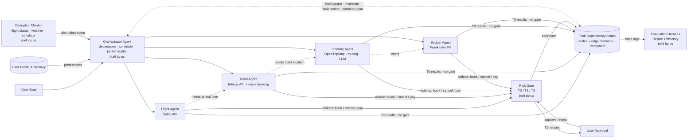
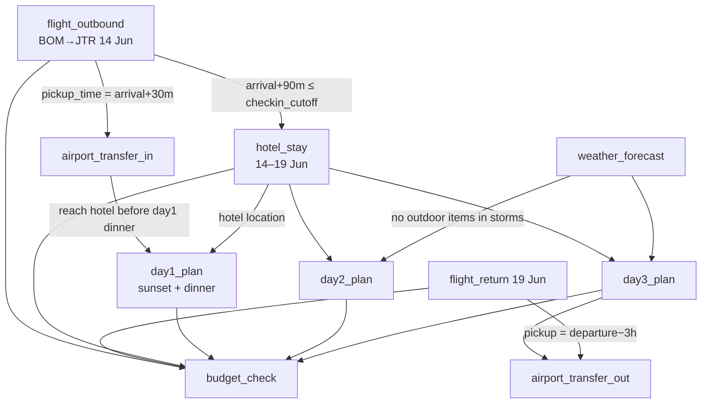

# VoyageSync
### A Dependency-Aware, Risk-Tiered Multi-Agent System for Adaptive Travel Planning

**Team:** Ashita Patel · Krupa Himte · Mahima Acharekar · Risha Deshmukh
**Guide:** Prof. Nancy Nadar · Dept. of Computer Engineering, DJSCE · 2025-26

---

## 1. One-line pitch

VoyageSync plans a trip as a **graph of dependent tasks**. When something breaks (for example, a flight delay), it **repairs only the parts of the plan that are actually affected**. It acts on its own for low-risk work and **asks the traveler before anything irreversible**, and it **measures how precisely it replanned**, not just whether the final itinerary looks good.

---

## 2. Problem

Existing travel tools (Skyscanner, Booking.com, Expedia, Tripadvisor, Google Maps) each handle one service. LLM travel agents (TravelAgent, APEC-Travel, TDAG) can generate itineraries, but they share three weaknesses:

1. **They treat the plan as a flat output.** When something changes, the whole plan is regenerated, or the agent can't tell which parts depend on the change.
2. **Their autonomy is all or nothing.** Either the agent only recommends, or it acts with no safety check before bookings or cancellations.
3. **Their evaluation is output-only.** They score the final itinerary, never how efficiently or how safely the system got there after a disruption.

---

## 3. Core idea and novelty

| # | Contribution | What is new | Gap it addresses |
|---|---|---|---|
| **N1** | **Typed Task Dependency Graph (TDG)** as the single source of truth for a trip | Every booking, transfer, day plan and budget check is a node. Edges record *why* one task depends on another. | TDAG decomposes tasks but cannot invalidate tasks that already succeeded. TravelAgent produces a flat plan. |
| **N2** | **Contract-checked partial replanning** | Each edge carries a *contract* (a checkable condition, e.g. "arrival + 90 min ≤ hotel check-in cutoff"). On a disruption, invalidation spreads **only across edges whose contract breaks**, so a 1-hour delay doesn't redo the hotel. | No surveyed system limits replanning to the impact of a change. |
| **N3** | **Risk-tiered action gate** | Every action is scored on reversibility, money at stake and how visible it is to the user. The tier is **T0 auto**, **T1 auto + notify** or **T2 needs approval**. | ReAct and TDAG have no human gate. APEC elicits preferences but does not gate execution. |
| **N4** | **Replan Efficiency metrics plus a disruption benchmark** | Replan precision, recall and F1 against a ground-truth affected set, along with plan stability, recovery latency, cost saved and unsafe-action rate, measured on a reproducible suite of injected disruptions. | TDAG has no replanning metric. ReAct uses only exact-match scores. |

> **Analogy for viva:** this is how build systems like Make and Bazel work. They rebuild only the targets whose inputs changed. VoyageSync brings that idea of incremental recomputation to agentic travel planning and adds contracts, so a change only counts when it actually violates a constraint.

---

## 4. What we build vs. what we use

As asked by our guide: **the Orchestrator and the Disruption Monitor are built from scratch by us.** The domain agents are thin wrappers over external APIs and an LLM.

| Component | Built by us | Backed by |
|---|---|---|
| **Orchestrator Agent** (planner, graph engine, replanner) | ✅ fully custom | LLM used only for decomposing the trip goal |
| **Disruption Monitor** (event ingestion, simulator, impact analysis) | ✅ fully custom | Flight status and weather APIs as event sources |
| **Risk Gate** (policy engine and approval workflow) | ✅ fully custom | — |
| **Evaluation Harness** (benchmark and metrics) | ✅ fully custom | — |
| Flight Agent | wrapper | Duffel API (test mode) |
| Hotel Agent | wrapper | Hotel listings API + mock booking provider |
| Itinerary Agent (day plans + transfers) | wrapper + LLM | OpenTripMap / Geoapify places, OpenRouteService / OSRM, LLM |
| Budget Agent | small custom logic | Frankfurter (currency rates) |

Weather data (Open-Meteo) is read by the **Disruption Monitor** for storm alerts and by the **Itinerary Agent** when planning outdoor activities, so it does not need its own agent.

We deliberately do **not** use a ready-made agent framework (LangGraph, CrewAI, AutoGen) for orchestration. The graph engine and replanning logic are the research contribution, so we write them ourselves.

---

## 5. Architecture

### 5.1 System diagram


*(Keep `VoyageSync_Architecture.png` in the same folder as this file so the image shows. This is the slide version of the architecture.)*

The diagram has five columns, read left to right:

| Column | Component | Role | Type |
|---|---|---|---|
| **Input** | User Goal | destination, budget, dates, preferences | — |
| | User Profile & Memory | past trips, saved preferences, approval history; read by the Orchestrator | database |
| **Orchestration** | Disruption Monitor | watches flight status and weather, runs the disruption simulator, and sends disruption events to the Orchestrator | **built by us** |
| | Orchestrator Agent | decomposes the goal into the task graph (with LLM help), schedules tasks, and runs the partial re-plan | **built by us** (uses an LLM API) |
| **Execution agents** | Flight Agent | fare search and rebooking | wrapper → Duffel API (test mode) |
| | Hotel Agent | accommodation search and booking | wrapper → listings API + mock booking provider |
| | Itinerary Agent | day plans, local insights, transfer timing | wrapper → OpenTripMap / Geoapify, OpenRouteService, LLM |
| | Budget Agent | cost validation across all tasks | small custom logic + Frankfurter FX |
| **Safety gate** | Risk Gate | lets low-risk work through and stops only book / cancel / pay (T2) | **built by us** |
| | User Approval | human-in-the-loop approve / reject for T2 actions | UI |
| **State & evaluation** | Task Dependency Graph | central shared state: nodes, edge contracts, versions. The card shows a mini example: a flight delay breaks the Flight → Transfer → Day 1 contracts (stale, redone) while Flight → Hotel still holds (kept). | **built by us** (part of the Orchestrator) |
| | Evaluation Harness | Replan Efficiency: precision, recall, stability, latency | **built by us** |

**Flows in the diagram**

1. **User Goal + User Profile & Memory → Orchestrator.** The Orchestrator builds the Task Dependency Graph, using the LLM to propose tasks.
2. **Orchestrator → agents.** Ready tasks are dispatched in dependency order. The small arrows between agent cards show this order: the Hotel Agent needs the flight's arrival time, the Itinerary Agent needs the hotel location, and the Budget Agent validates all costs. The order comes from the graph, not a fixed pipeline.
3. **Agents → Task Dependency Graph (top route).** Low-risk results (searches, comparisons, draft plans) are written straight to the graph. They are **T0** and do not pass through the gate.
4. **Agents → Risk Gate.** Only actions with consequences (book, cancel, change, pay) go to the gate.
5. **Risk Gate ⇄ User Approval.** T2 actions wait for the traveler's approve / reject. Approved actions are executed and recorded in the graph.
6. **Disruption Monitor → Orchestrator.** A disruption event (delay, cancellation, storm) reaches the Orchestrator.
7. **Orchestrator ⇄ Task Dependency Graph (dashed loop).** The Orchestrator checks edge contracts, marks only the nodes whose contracts break as stale, and regenerates just those. This is the **partial re-plan**.
8. **Task Dependency Graph → Evaluation Harness (dotted).** The harness only reads trace logs and computes the metrics. It never triggers a replan.

The same architecture as a Mermaid diagram (renders on GitHub):



### 5.2 Changes from the original slide

These are the small changes made to the original architecture. The column layout and the components stayed the same.

| Original design | Problem | Revised design |
|---|---|---|
| Replan arrow from Evaluation Harness → Orchestrator | The metric looked like it triggered replans | The **Disruption Monitor** triggers replans. The re-plan loop now runs between the **Orchestrator and the Task Dependency Graph**, and the Harness only observes trace logs. |
| Every agent passes through the Risk Gate | It contradicted "search is autonomous" | Low-risk results go **directly to the graph (T0)**. Only book / cancel / pay go through the gate. |
| No path back to the user | Human-in-the-loop was claimed but not shown | Added a **User Approval** box with an approve / reject loop. |
| Built and external parts not distinguished | Unclear what the team implements | **"Built by us"** badges on the Orchestrator, Disruption Monitor, Risk Gate and Evaluation Harness; each agent shows the API it wraps. |
| Disruption Monitor with no inputs | Unclear where events come from | The Monitor lists its sources: **flight status, weather, simulator**. |
| Task Dependency Graph looked like a final output | The core idea (dependencies) was invisible | The graph card is labelled **central shared state** and shows a **mini example** of contract-checked invalidation (✗ broken → redo, ✓ holds → keep). |
| Agents looked independent and parallel | Hid the dependency-aware design | **Dependency arrows** between agents (needs arrival time → needs hotel location → validates all costs). |
| No LLM or user memory shown | Incomplete picture of the system | Orchestrator card shows the **LLM API**, and a **User Profile & Memory** card feeds the Orchestrator. |

### 5.3 Example Task Dependency Graph (Mumbai → Santorini, 5 nights)



**Scenario: `flight_outbound` is delayed by 5 hours.**

- `F1 → T1` contract breaks: pickup time changes. **`airport_transfer_in` is re-run.**
- `T1 → D1` contract breaks: traveler misses sunset. **`day1_plan` is re-run.**
- `F1 → H1` contract still holds: check-in is open until midnight. **The hotel is untouched.**
- `day2`, `day3`, return flight and outbound transfer are **untouched**.
- `budget_check` is re-run because its inputs changed.

Result: **3 of 12 nodes regenerated** instead of 12. That gap is what the metrics capture.

---

## 6. Component design

### 6.1 Task Dependency Graph (data model)

```python
class TaskNode(BaseModel):
    id: str                    # "hotel_stay"
    type: TaskType             # FLIGHT | STAY | TRANSFER | DAY_PLAN | WEATHER | BUDGET (each mapped to one of the 4 agents)
    agent: str                 # which agent executes it
    inputs: dict               # resolved from parent outputs
    output: dict | None        # agent result (offer, booking, plan…)
    status: Status             # PENDING | READY | RUNNING | DONE | STALE |
                               # AWAITING_APPROVAL | FAILED
    version: int               # increments on every regeneration
    risk_tier: Tier | None     # set when the task implies an action

class Edge(BaseModel):
    src: str
    dst: str
    contract: Contract         # checkable condition over src.output and dst.output
    description: str           # human-readable reason (shown in UI)
```

A contract is a small Python check, generated from templates, never free-form LLM text:

```python
class ArrivalBeforeCheckin(Contract):
    def holds(self, flight, hotel) -> bool:
        return flight["arrival"] + timedelta(minutes=90) <= hotel["checkin_cutoff"]
```

Storage: graph state kept in SQLite/PostgreSQL, with **every version kept** so we can show a diff and roll back.

### 6.2 Orchestrator Agent (custom)

Responsibilities:

1. **Decompose.** It turns the user goal into a graph. The LLM proposes tasks from a fixed **task-type vocabulary**, and the Orchestrator attaches edges and contracts from templates. That keeps the graph valid and checkable.
2. **Schedule.** It runs a topological sort and dispatches every READY node (all parents DONE), running independent nodes in parallel.
3. **Replan.** When it receives an invalidation from the Monitor, it runs contract-checked propagation (below) and then re-schedules only the STALE nodes.
4. **Preserve context.** A regenerated agent receives its untouched neighbours as fixed constraints, so the new day 1 plan still fits the existing hotel.

**Contract-checked invalidation**

```
procedure PROPAGATE(changed_node n):
    queue ← [n]
    while queue not empty:
        u ← queue.pop()
        for each edge (u → v):
            if v.status == DONE and not edge.contract.holds(u.output, v.output):
                v.status ← STALE
                queue.push(v)
            # contract still holds → stop; v and its subtree are kept
    run SCHEDULE on STALE nodes in topological order
```

This is compared against two baselines:
- **B1 Full replan:** discard everything and regenerate (what a ReAct-style agent does).
- **B2 Naive downstream:** mark *every* descendant stale, without checking contracts.

### 6.3 Disruption Monitor (custom)

- **Live sources:** polls flight status for booked flights and weather for trip dates (APScheduler, every N minutes).
- **Disruption Simulator:** injects scripted events (delay X h, cancellation, hotel overbooked, storm on day 3, price spike) with fixed random seeds. This drives both the demo and the benchmark, since real disruptions can't be summoned on demand.
- **Normalisation:** every event becomes `DisruptionEvent{type, target_node, new_facts, severity, timestamp}`.
- **Impact pre-check:** it updates the target node's facts and passes the event to the Orchestrator's `PROPAGATE`. Events with no effect (e.g. a 10-minute delay) are logged and dropped.
- **Deduplication:** repeated alerts for the same flight are merged.

### 6.4 Risk Gate (custom)

Each proposed action gets a risk score:

```
risk = w1·irreversibility + w2·normalised_cost + w3·user_visibility + w4·(1 − agent_confidence)
```

| Tier | Typical actions | Behaviour |
|---|---|---|
| **T0: Autonomous** | search, compare, fetch weather, draft a day plan | runs immediately |
| **T1: Notify** | reorder activities, swap a free activity, reschedule a transfer that is still pending | runs, then tells the user, with undo |
| **T2: Approve** | book, cancel, change a flight, any spend above a threshold, non-refundable items | **pauses** and sends an approval card (option, price, what changes, why) to the UI |

Hard rules override the score: payment and cancellation are always T2, and money is never spent in T0 or T1. If an approval times out, the offer is held and the user is reminded; the system never auto-executes.

### 6.5 Domain agents (API wrappers)

Every agent has the same interface, so the Orchestrator treats them uniformly:

```python
class Agent(Protocol):
    async def run(self, node: TaskNode, frozen_context: dict) -> AgentResult: ...
    async def execute_action(self, action: Action) -> ActionResult: ...   # only after Risk Gate
```

Each agent validates the API response before writing it to the graph (schema check, sanity checks such as "price > 0" and "arrival after departure"). This addresses ReAct's problem of bad tool outputs flowing straight into reasoning.

### 6.6 Evaluation Harness (custom)

**Benchmark:** about 10 trip templates (domestic and international, 3–7 days, solo and group) × about 10 disruption types × several severities, giving **100+ reproducible scenarios**.

**Ground truth:** for each scenario, an *oracle* re-checks every constraint with full knowledge of the new facts, which gives the true affected set **A**. A hand-labelled subset is used to validate the oracle.

| Metric | Definition |
|---|---|
| **Replan Precision** | \|R ∩ A\| / \|R\| (R = nodes regenerated) |
| **Replan Recall** | \|R ∩ A\| / \|A\|. Missing an affected node means a broken plan. |
| **Replan F1** | harmonic mean of the two |
| **Plan Stability** | share of user-visible items unchanged after the replan |
| **Constraint Satisfaction** | share of all contracts that hold after the replan |
| **Recovery Latency** | time from event to a valid plan |
| **Cost of Replan** | LLM tokens + API calls used |
| **Unsafe Action Rate** | T2 actions executed without approval (target: **0**) |

**Experiments:**
1. Ours vs. B1 (full replan) vs. B2 (naive downstream) on every metric.
2. Ablations: without contracts, without frozen context, without Risk Gate.
3. A small user study (10–15 participants) rating trust and approval-prompt fatigue.

Expected result to report: recall comparable to B1, with clearly higher precision, stability and lower cost.

---

## 7. Tech stack

| Layer | Choice | Reason |
|---|---|---|
| Backend | **Python 3.11, FastAPI, Pydantic** | async agents, typed models |
| Graph engine | **Custom** (NetworkX only for topological sort and visualisation helpers) | core contribution |
| Scheduling / monitor | **APScheduler** + asyncio | polling and simulated events |
| Storage | **PostgreSQL** (or SQLite for development) via SQLModel | versioned graph state, traces |
| Live updates | **WebSockets / Server-Sent Events** | push approval cards and replans to the UI |
| LLM | Any function-calling LLM (e.g. Gemini or GPT-class models via API) | decomposition and day plans only |
| Frontend | Our existing **React** UI + **React Flow** | live graph view with stale nodes highlighted |
| Evaluation | pytest + pandas + matplotlib | benchmark runs and charts |
| DevOps | Docker Compose, GitHub Actions | reproducible demo |

### 7.1 External APIs (updated for 2026)

> ⚠️ **Update the "Data sources" slide.** Amadeus shut down its free Self-Service APIs on **17 July 2026**. Skyscanner, Booking.com, Airbnb and Tripadvisor APIs require commercial partner approval, which students are unlikely to get.

| Need | Recommended | Notes |
|---|---|---|
| Flight search, booking, changes | **Duffel API, test mode** | free sandbox with a test airline ("Duffel Airways"). Supports search, booking and order changes, which is ideal for rebooking demos. |
| Flight status (Monitor) | AviationStack / AirLabs free tier | check current free-tier limits; the **Simulator** is the main source for demos |
| Hotels | Hotel/place listings (Geoapify or Google Places) + **our own mock booking provider** | keeps booking realistic without partner access |
| Places / attractions | OpenTripMap, Geoapify Places | free tiers |
| Routing / travel time | OpenRouteService or OSRM | free |
| Weather | **Open-Meteo** (no key) or OpenWeatherMap | free |
| Currency | Frankfurter | free |

Every agent has a **mock mode** that returns recorded responses, so development and benchmark runs don't depend on rate limits.

---

## 8. Repository structure

```
voyagesync/
├── backend/
│   ├── core/
│   │   ├── graph.py            # TaskNode, Edge, versioned store
│   │   ├── contracts.py        # contract templates
│   │   ├── orchestrator.py     # decompose, schedule, propagate, replan
│   │   ├── risk_gate.py        # scoring, tiers, approval workflow
│   │   └── monitor/
│   │       ├── monitor.py      # polling + event normalisation
│   │       └── simulator.py    # scripted disruption injection
│   ├── agents/
│   │   ├── base.py
│   │   ├── flight.py  hotel.py
│   │   ├── itinerary.py  budget.py
│   ├── api/                    # FastAPI routes + WebSocket
│   └── db/
├── eval/
│   ├── scenarios/              # trip templates + disruption scripts (YAML)
│   ├── oracle.py               # ground-truth affected set
│   ├── baselines.py            # full replan, naive downstream
│   ├── run_benchmark.py
│   └── report.ipynb
├── frontend/                   # existing React UI + graph view + approval cards
├── docker-compose.yml
└── README.md
```

### 8.1 Key API endpoints

| Method | Endpoint | Purpose |
|---|---|---|
| POST | `/trips` | submit goal → build graph → start planning |
| GET | `/trips/{id}/graph` | current graph with node statuses |
| GET | `/trips/{id}/itinerary` | user-facing plan |
| POST | `/trips/{id}/disruptions` | inject a simulated event (demo/eval) |
| GET | `/approvals` | pending T2 actions |
| POST | `/approvals/{id}` | approve / reject |
| WS | `/ws/trips/{id}` | live updates (node status, approvals, replans) |

---

## 9. Prototype build plan (about 14 weeks)

| Phase | Weeks | Deliverable | Done when |
|---|---|---|---|
| **0. Setup** | 1 | Repo, Docker, API keys (Duffel test, Open-Meteo, places, LLM), mock-mode framework | `docker compose up` runs the backend and UI |
| **1. Graph engine** | 2–3 | TaskNode/Edge models, versioned store, contract templates, topological scheduler with **mock agents** | a hand-written graph executes end to end in the correct order |
| **2. Orchestrator** | 4–5 | LLM decomposition into the fixed task vocabulary, auto edge/contract attachment, parallel dispatch | "Santorini, 5 nights, $3k" produces a valid graph and plan |
| **3. Real agents** | 5–7 | Flight (Duffel), Hotel, Itinerary (incl. transfers), Budget wrappers with output validation | a full trip plan built from live or sandbox data |
| **4. Disruption Monitor** | 7–9 | Simulator, live polling, event normalisation, `PROPAGATE`, partial replan with frozen context | flight delay → only affected nodes regenerate (visible in logs) |
| **5. Risk Gate + approvals** | 9–10 | Scoring, tiers, approval cards over WebSocket, sandbox booking and rebooking after approval | rebooking waits for the user's click; unsafe-action rate is 0 |
| **6. UI integration** | 10–11 | React Flow graph view (stale = amber, regenerated = green), approval modal, "Simulate disruption" panel | the full demo runs from the browser |
| **7. Evaluation** | 11–13 | Scenario suite, oracle, baselines B1/B2, ablations, charts | results table + plots ready for the report |
| **8. Write-up** | 13–14 | Report, paper draft, final slides, demo video | submitted |

### 9.1 Suggested team split

| Role | Owns |
|---|---|
| Member 1: **Core / Orchestrator** | graph engine, contracts, scheduler, `PROPAGATE` |
| Member 2: **Monitor + Risk Gate** | simulator, polling, event model, risk scoring, approval flow |
| Member 3: **Agents + APIs** | all agent wrappers, mock mode, output validation |
| Member 4: **Frontend + Evaluation** | graph view, approval UI, benchmark, oracle, metrics |

Everyone reviews each other's pull requests, and everyone contributes to the report.

---

## 10. Demo script (5 minutes, for viva/exhibition)

1. **Plan:** enter "Santorini, 14–19 Jun, $2–4k, slow luxury, solo". The graph builds live in React Flow and the itinerary appears.
2. **Approve:** the system proposes booking a flight and hotel, and approval cards appear (T2). Approve both; the sandbox booking is confirmed.
3. **Disrupt:** click *Simulate → outbound flight delayed 5h*.
4. **Watch:** 3 nodes turn amber (stale), the rest stay grey. The transfer and day 1 regenerate, and the hotel stays untouched. A toast says "Rebooked pickup for 19:30 (T1, undo)".
5. **Escalate:** simulate a *cancellation*. The flight agent finds alternatives and the Risk Gate pauses with an approval card showing the price difference.
6. **Measure:** open the metrics panel to see this replan's precision, recall and stability next to the full-replan baseline.

---

## 11. Updated literature mapping

| Paper | What it does | Gap | How VoyageSync addresses it |
|---|---|---|---|
| TDAG (Wang et al., *Neural Networks*, 2025) | dynamic decomposition into generated sub-agents; ItineraryBench | replanning is failure-driven only; can't invalidate finished tasks; no human gate; static data; no replan metric | **N1 + N2** invalidation of finished tasks; **N3**; live APIs; **N4** |
| ReAct (Yao et al., ICLR 2023) | reasoning and acting interleaved in one agent | single linear agent; repetitive loops; no tool-output checks; no confirmation gate | multi-agent graph; output validation in each agent; **N3** |
| TravelAgent (Chen et al., 2024) | tool, recommendation, planning and memory modules; personalised itineraries | focused on initial generation; weak continuous adaptation | **N2** partial replanning of a live plan |
| Towards Full Delegation / APEC (Jiang et al., 2024) | agent constitution; proactive preference elicitation | little post-planning modification, booking or budget management | full lifecycle: plan → approve → book → monitor → repair |
| Tourist Destination Recommendation (IEEE, 2025) | deep-learning destination prediction | recommendation only | end-to-end planning and execution |
| **Suggested addition:** TravelPlanner (Xie et al., ICML 2024) | benchmark showing LLM agents often violate constraints in travel plans | static, one-shot planning | contracts make constraints explicit and checkable after every change |

---

## 12. Risks and mitigations

| Risk | Mitigation |
|---|---|
| API access or rate limits | mock mode with recorded responses; Duffel sandbox; free APIs |
| LLM produces an invalid graph | fixed task vocabulary + template edges + schema validation; retry with an error message |
| Contracts miss a real dependency (low recall) | oracle-based recall measurement; fall back to naive downstream when unsure |
| Too many approval prompts | tier thresholds tuned in the user study; batch approvals per disruption |
| Scope creep | Phases 1–5 are the minimum viable prototype; UI polish comes after |

---

## 13. Resume bullets (once built)

- **Designed and built VoyageSync**, a multi-agent travel planner in Python/FastAPI that represents trips as a typed task dependency graph with constraint contracts on edges, enabling **partial replanning** that regenerated about X% fewer tasks than full replanning at equal plan validity.
- **Implemented a custom orchestrator and real-time disruption monitor** that propagate invalidation only across violated dependencies; integrated Duffel, OpenRouteService and Open-Meteo APIs through a uniform agent interface with output validation.
- **Built a risk-tiered human-in-the-loop action gate** (autonomous / notify / approve) for bookings and cancellations, achieving **zero unapproved high-risk actions** across 100+ simulated disruption scenarios.
- **Created a disruption benchmark and Replan Efficiency metrics** (precision, recall, plan stability, recovery latency) and evaluated against full-replan and naive-propagation baselines.

*(Fill in the real numbers after Phase 7. Reporting actual measured results is what makes these bullets credible.)*

---

## 14. Possible publication angle

**Title idea:** *"Contract-Checked Partial Replanning for Agentic Travel Planning under Real-World Disruptions."*
**Contributions:** (1) a typed task-graph representation with edge contracts, (2) an invalidation algorithm limited to the impact of a change, (3) a risk-tiered execution gate, and (4) a disruption benchmark with replan-efficiency metrics. This is suitable for an IEEE conference or a student research track.
