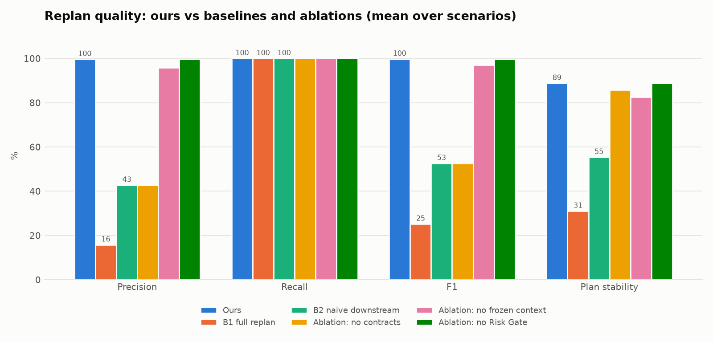
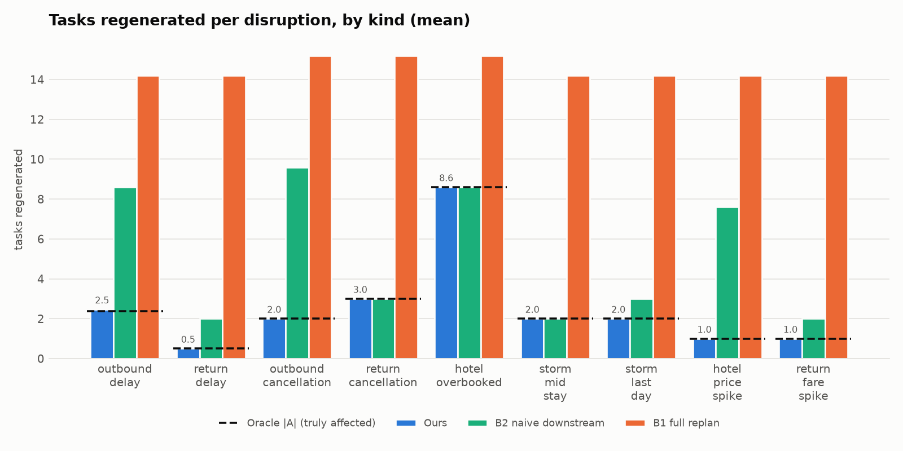

# VoyageSync: evaluation results

Benchmark of contract-checked partial re-planning (ours) against a full replan (B1), naive downstream
invalidation (B2) and three ablations, on **160 disruption scenarios**. All numbers come from
`eval/run_benchmark.py` (run 2026-10-16, mock mode, fully offline). The raw per-run data is in
`results/results.csv` (drift on) and `results/results_no_drift.csv`; the aggregates are in
`results/summary.json` / `results/summary.md`.

Reproduce:

```powershell
backend\.venv\Scripts\python.exe -m pip install -r eval\requirements.txt
backend\.venv\Scripts\python.exe eval\generate_scenarios.py
backend\.venv\Scripts\python.exe eval\run_benchmark.py
```

Two runs give identical results; only latency varies with the machine.

## 1. Setup

| Item | Value |
|---|---|
| Trip templates | 10 (`scenarios/trips.yaml`): 2 domestic (India) and 8 international; 3–7 nights; 1–5 travellers; USD, INR, GBP, EUR and AUD budgets; budget to luxury |
| Disruptions | 9 kinds × severities = 16 per trip (`scenarios/disruptions.yaml`): outbound delay 15 min → 10 h (6 levels), return delay (2), outbound and return cancellation, hotel overbooked, storm mid-stay and on the last day, hotel price +10 % / +30 %, return fare +60 % |
| Scenarios | **160** (`scenarios/scenarios.yaml`); severities 30 low / 50 medium / 70 high / 10 extreme |
| Procedure | Each trip is planned once and its 3 bookings are approved by a simulated user. Every scenario × strategy then re-plans an identical deep copy of that booked trip. |
| Market drift | Real APIs change between searches. With drift on, each re-search sees prices move by up to ±8 % and each offer, hotel or place become unavailable with 15 % probability. The drift is seeded per scenario, so every strategy faces exactly the same market. Results are reported with drift **on** (main) and **off**. |
| Ground truth | The **oracle** (`oracle.py` → `app/core/metrics.py`) starts from the graph before the event, applies it, then repeatedly re-checks every contract in the graph with full knowledge of the new facts. It regenerates the shallowest broken nodes until all contracts hold. Its regenerated set is A. It runs with drift off. |
| Oracle check | 71 scenarios carry **hand labels** (`scenarios/labels.yaml`), written from the domain rules before the oracle was run. Result: **71 / 71 agree**. |

Strategies, all behind the same `Orchestrator.handle_disruption` interface and the same Risk Gate:

| Strategy | Invalidation | Frozen context | Risk Gate |
|---|---|---|---|
| **Ours** | contract-checked PROPAGATE | yes | yes |
| B1 full replan | everything except pinned facts | no | yes |
| B2 naive downstream | every descendant of the changed node | no | yes |
| Ablation: no contracts | every descendant (no contract checks) | yes | yes |
| Ablation: no frozen context | contract-checked PROPAGATE | no | yes |
| Ablation: no Risk Gate | contract-checked PROPAGATE | yes | **no**: T2 actions execute immediately |

Metrics follow plan §6.6:
- **R** is the set of nodes a strategy marks for regeneration.
- **Replan precision** = |R∩A| / |R|; **recall** = |R∩A| / |A|; **F1** combines the two.
- **Plan stability** is the share of user-visible items (flights, stay, transfers, day plans) the traveller
  sees unchanged: the same flight and times, hotel and dates, pickups, and activities. The disrupted item
  itself is not counted.
- **Constraint satisfaction** is the share of contracts holding after the replan.
- **Recovery latency** runs from the event to a valid plan.
- **Cost** is the number of LLM and API calls.
- **Unsafe-action rate** is the number of T2 actions executed without the user's approval divided by the
  number of T2 actions raised.

## 2. Main results (drift on, 160 scenarios)

| Strategy | Precision | Recall | F1 | Stability | Constraints | All contracts hold | Tasks regenerated | Latency p50 / p95 (ms) | LLM / API calls | T2 prompts | Unsafe actions |
|---|---|---|---|---|---|---|---|---|---|---|---|
| **Ours** | **99.6 %** | **100.0 %** | **99.7 %** | **88.8 %** | 99.8 % | 93.8 % | **2.27** | **0.8 / 2.3** | **0.22 / 1.64** | **31** | **0 / 31 (0 %)** |
| B1 full replan | 15.8 % | 100.0 % | 25.2 % | 31.0 % | 99.8 % | 93.8 % | 14.39 | 4.9 / 9.1 | 4.49 / 14.26 | 134 | 0 / 134 (0 %) |
| B2 naive downstream | 42.7 % | 100.0 % | 52.6 % | 55.4 % | 99.8 % | 93.8 % | 6.19 | 2.2 / 3.8 | 2.89 / 5.69 | 66 | 0 / 66 (0 %) |
| Ablation: no contracts | 42.7 % | 100.0 % | 52.6 % | 85.7 % | 99.8 % | 93.8 % | 6.19 | 2.0 / 3.1 | 0.23 / 5.69 | 41 | 0 / 41 (0 %) |
| Ablation: no frozen context | 95.8 % | 100.0 % | 97.1 % | 82.6 % | 99.8 % | 93.8 % | 2.49 | 0.9 / 3.0 | 0.73 / 1.86 | 34 | 0 / 34 (0 %) |
| Ablation: no Risk Gate | 99.6 % | 100.0 % | 99.7 % | 88.8 % | 99.8 % | 93.8 % | 2.27 | 0.8 / 2.6 | 0.22 / 1.64 | 31 | **31 / 31 (100 %)** |

Headline comparisons, ours vs B1:

| Comparison | Result |
|---|---|
| Tasks regenerated | **84.2 % fewer** (2.27 vs 14.39 per disruption) |
| Recall | the same: **100 %** for both |
| Replan precision | **99.6 % vs 15.8 %** |
| Plan stability | **88.8 % vs 31.0 %** |
| LLM calls | **95.1 % fewer** (0.22 vs 4.49) |
| API calls | **88.5 % fewer** (1.64 vs 14.26) |
| Median recovery latency | 6.2× lower in mock mode (0.8 ms vs 4.9 ms) |
| Approval prompts | 0.19 vs 0.84 per disruption (31 vs 134 T2 cards) |
| Unsafe-action rate | **0 % for every gated strategy** (0 of 306 T2 actions raised across them); 100 % without the gate |




## 3. Without market drift (deterministic mocks)

| Strategy | Precision | Recall | F1 | Stability | Tasks regenerated | LLM / API calls | T2 prompts |
|---|---|---|---|---|---|---|---|
| **Ours** | 100.0 % | 100.0 % | 100.0 % | 88.9 % | 2.24 | 0.22 / 1.61 | 30 |
| B1 full replan | 15.8 % | 100.0 % | 25.2 % | 85.8 % | 14.39 | 4.49 / 14.26 | 30 |
| B2 naive downstream | 42.7 % | 100.0 % | 52.6 % | 85.8 % | 6.19 | 2.89 / 5.69 | 30 |
| Ablation: no contracts | 42.7 % | 100.0 % | 52.6 % | 87.3 % | 6.19 | 0.23 / 5.69 | 30 |
| Ablation: no frozen context | 96.9 % | 100.0 % | 97.9 % | 87.4 % | 2.36 | 0.62 / 1.73 | 30 |
| Ablation: no Risk Gate | 100.0 % | 100.0 % | 100.0 % | 88.9 % | 2.24 | 0.22 / 1.61 | 30 (30 unsafe) |

The selection metrics (precision, recall, regenerated, cost) are the same with and without drift; they
depend on the contracts, not on the market. **Stability is where drift matters.** With deterministic mocks,
a full replan re-searches and gets the very same answers, so B1 looks almost as stable as ours (85.8 % vs
88.9 %). With a realistic market, B1's re-searched flights, hotels and activities change and its stability
drops to 31.0 %, while ours stays at 88.8 % because it re-searches only the affected tasks. This is why
open question 10 asked for drift. We report both settings rather than only the favourable one.

## 4. By disruption kind (drift on): tasks regenerated / F1 / stability

| Kind | Mean |A| | Ours | B2 naive | B1 full |
|---|---|---|---|---|
| outbound delay (6 levels) | 2.37 | 2.47 / 0.99 / 0.82 | 8.60 / 0.41 / 0.29 | 14.20 / 0.28 / 0.26 |
| return delay | 0.50 | 0.50 / 1.00 / 0.94 | 2.00 / 0.33 / 0.88 | 14.20 / 0.07 / 0.28 |
| outbound cancellation | 2.00 | 2.00 / 1.00 / 1.00 | 9.60 / 0.35 / 0.28 | 15.20 / 0.24 / 0.28 |
| return cancellation | 3.00 | 3.00 / 1.00 / 0.88 | 3.00 / 1.00 / 0.88 | 15.20 / 0.34 / 0.27 |
| hotel overbooked | 8.60 | 8.60 / 1.00 / 0.76 | 8.60 / 1.00 / 0.24 | 15.20 / 0.72 / 0.21 |
| storm mid-stay | 2.00 | 2.00 / 1.00 / 0.89 | 2.00 / 1.00 / 0.89 | 14.20 / 0.25 / 0.30 |
| storm on last day | 2.00 | 2.00 / 1.00 / 0.89 | 3.00 / 0.80 / 0.89 | 14.20 / 0.25 / 0.32 |
| hotel price spike | 1.00 | 1.00 / 1.00 / 1.00 | 7.60 / 0.24 / 0.59 | 14.20 / 0.14 / 0.54 |
| return fare spike | 1.00 | 1.00 / 1.00 / 1.00 | 2.00 / 0.67 / 1.00 | 14.20 / 0.14 / 0.41 |

## 5. Analysis

- **Contracts drive precision.** Removing the contract checks (the "no contracts" ablation) drops precision from
  99.6 % to 42.7 % and regenerates 2.7× more tasks, with the same recall. B2 reaches the same precision; it
  is exactly the no-contracts strategy without frozen context. The gap is largest where an event touches a
  node with many descendants but breaks few contracts: a hotel price spike (1 vs 7.6 tasks) or an outbound
  cancellation with a same-arrival replacement (2 vs 9.6). Where every descendant really is affected (hotel
  overbooked, return cancellation, a storm mid-stay), B2 and ours coincide. That is expected: the contract
  check only helps when it can stop the propagation.
- **Frozen context drives stability and cost.** Without it, the re-planned agents optimise from scratch, for
  example taking the cheapest replacement flight rather than the one that keeps the old arrival time.
  Stability falls from 88.8 % to 82.6 %, LLM calls rise 3.3× (0.22 → 0.73), and precision drops to 95.8 %,
  because a different replacement breaks contracts that a minimal-change repair would have kept. With
  contracts removed as well, the frozen context alone keeps stability at 85.7 %.
- **Recall is 100 % for every strategy.** No strategy left an affected task stale. For B1 and B2 this holds by
  construction (they regenerate supersets). For ours it is the claim under test: contract-checked propagation
  never missed a node the global oracle found.
- **The Risk Gate costs nothing in replan quality and is solely responsible for safety.** The no-gate
  ablation matches ours on every quality metric, but every one of its 31 T2 actions (re-bookings after
  cancellations and overbookings) was executed without approval. With the gate, 0 of 306 T2 actions raised
  across the five gated strategies executed without an explicit approval. B1 also asks the user far more
  often: 134 approval prompts vs 31, because a full replan under drift picks different flights and hotels
  and each needs a re-booking approval. This is the prompt-fatigue risk named in plan §12.
- **Precision is 99.6 %, not 100 %, with drift.** In one scenario (Bali, 10 h delay) the hotel had to be
  re-checked, the drifted market had "sold out" the original hotel, and the replacement cascaded to the
  transfers and day plans. That is a real-world effect, not a propagation error. Without drift, ours
  matches the oracle exactly on all 160.

## 6. Limitations (stated plainly)

1. **The oracle is contract-based.** It re-checks every contract globally, but it can't see a dependency that
   no contract encodes. That is why ours and the oracle coincide almost everywhere. The 71/71 agreement
   with the hand labels supports the oracle on the labelled kinds. The labels were written by reasoning
   about the same domain rules, by the assistant that built the system, so the team should review
   `scenarios/labels.yaml`. Storms, mid-severity delays and the extreme cases are not hand-labelled.
2. **The data is synthetic.** The flights, hotels, places and prices come from mocks with recorded weather and
   FX. The drift model (±8 % price, 15 % unavailability) is our assumption, not measured market behaviour;
   the no-drift table shows the results without it.
3. **Latency is mock-mode latency** (sub-millisecond to a few ms of planning logic, no network). With live
   APIs, latency would be dominated by API calls, which is where the 88.5 % reduction in API calls matters.
   The absolute numbers vary between machines.
4. **10 scenarios (6 %) are unrepairable by every strategy.** A 10 h outbound delay lands after the hotel's
   23:59 check-in cutoff, and no agent can change a hotel's cutoff (a "request late check-in" action does
   not exist). Constraint satisfaction stays at 99.8 % (the check-in contract stays broken) and "all contracts
   hold" at 93.8 % for every strategy. The system leaves the violation visible instead of hiding it.
5. **The benchmark found and fixed a real bug.** In the first run, 7 scenarios with an 8 h delay reported a
   broken "transfer before day start" contract. Day 1 had no activities left, and the contract errored
   instead of holding vacuously. It was fixed in `app/core/contracts.py` (with tests) and the benchmark was
   re-run. The metric definitions and the labels were not changed.
6. **No user study.** The trust and approval-fatigue study in plan §6.6 (10–15 participants) was not run. The
   T2 prompt counts above are the only proxy.

## 7. Figures

| File | Shows |
|---|---|
| `results/quality.png` | precision, recall, F1 and stability for all six strategies |
| `results/regenerated_by_kind.png` | tasks regenerated per kind for ours / B2 / B1, with the oracle |A| |
| `results/cost_llm.png`, `results/cost_api.png` | LLM and API calls per re-plan |
| `results/latency.png` | median recovery latency with the p95 marker |
| `results/unsafe_actions.png` | unsafe-action rate per strategy |
